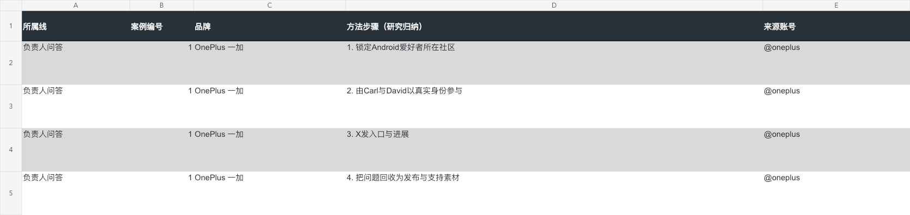
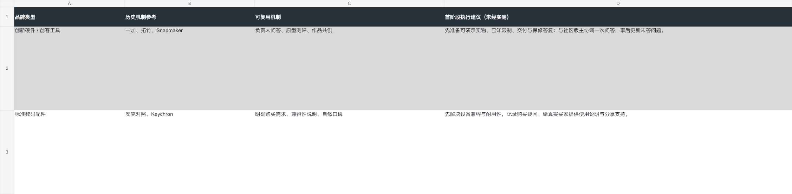
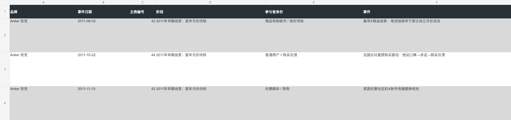

# social-case-to-excel

SNSの投稿を、出典を確認できる事例集・手法の分析・画像付き調査資料に整理する skill です。

[中文](README.md) · [English](README.en.md) · [日本語](README.ja.md) · [한국어](README.ko.md) · [Français](README.fr.md) · [Deutsch](README.de.md) · [Español](README.es.md) · [Italiano](README.it.md) · [Português](README.pt.md) · [हिन्दी](README.hi.md)

## どのような調査に使うか

このワークフローで、ブランドの海外進出初期の経緯、SNS運営の事例、コメントに表れる顧客ニーズを整理してきました。行動と公開された結果だけでなく、実行手順、前提条件、他のブランドが参考にできる点もまとめます。

機器ブランドは調査対象の一例です。AI広告、製品の立ち上げ、越境EC、コンテンツ運営などにも、テーマを指定して利用できます。

| 成果物 | 内容 |
| --- | --- |
| Excel事例集 | 主体、行動、報告された結果、日付、投稿リンク、分類、証拠の限界 |
| 手法の分析 | 実行手順、必要条件、ブランド別の応用案 |
| 画像・スクリーンショット | 対応する投稿画像、動画の表紙、スクリーンショットと出典説明 |
| 学習用文書 | 発見、事例、手法をまとめたMarkdown。必要に応じてHTMLも作成 |
| 候補データ | 検索範囲と未採用の記録を残し、再確認や追加調査に利用 |

## 活用シーン：事例から業務判断へ

| 用途 | 調べる内容 | 活用できる成果物 |
| --- | --- | --- |
| B2Bの顧客獲得 | SNS施策、信頼形成、問い合わせにつながる行動と公開結果 | 事例集、チャネル・コンテンツの実験案 |
| ブランド・海外進出 | 公式、利用者、メディア、管理者による初期活動 | 時系列、立ち上げ手法と応用案 |
| AI広告 | 画像・動画の発想、制作方法、AI技法 | 参考事例と調整可能なプロンプト案。推定案は作者の原文と区別 |
| 市場・製品調査 | 利用者、用途、障害、求められる機能 | シナリオ整理と検証項目 |
| 競合分析 | ポジショニング、機能、付属品、サービス | 比較表と差別化の仮説 |
| レビュー・低評価 | 実際の感想、不満、利用上の問題 | 改善案、FAQ、コンテンツ案。少数意見を市場比率に換算しない |
| Redditコミュニティ | 議論、ルール、ニーズ、宣伝投稿 | 有益な参加方法。偽装口コミや大量投稿は行わない |
| 公共機関のSNS分析 | 政策、公共サービスへの意見、公開議論 | 中立な論点整理と時系列。投稿量は世論調査ではない |
| 1688での仕入れ調査 | 供給者、セット、SKU、最低注文数、段階価格 | 購入候補と確認事項。品質や正規代理店資格を断定しない |
| EC間の価格比較 | 1688、Amazon、Temu、Walmartの型番、数量、付属品 | 商品化の比較。価格差を利益とみなさない |

EC・仕入れ・公共課題はテーマに合わせて構成する拡張ワークフローであり、同梱のワンクリック機能ではありません。実際に公開されたClaudeBabyツールと項目を確認し、不足を明記します。

## 実際の用途と目的

| 調査 | 意図 | 支援する目標 |
| --- | --- | --- |
| 中国ブランドの海外進出初年度、XとReddit | 非公式の議論を含め初期行動を追う | 起業チームが立ち上げ方法を学ぶ |
| B2BのSNS顧客獲得 | 信頼と問い合わせにつながる施策を学ぶ | チャネルの実験を設計する |
| 独立サイト、SEO/GEO、Reddit | 宣伝だけの投稿を除き実践を探す | 検索・コンテンツ・コミュニティ施策を選ぶ |
| AI広告 | 発想と制作方法を他ブランドに応用する | 制作計画を準備する。広告成果の保証ではない |
| ESP32とAgent/AI | 開発して再現できる用途を探す | AuraBabaの接続、デモと利用者獲得の計画 |
| ESP32の仕入れと海外EC比較 | 低価格部品、セット、SKUを確認する | 購入候補と商品化案。購入・量産・利益の実績ではない |

事例発見 → 手法分析 → 利用者とニーズ → 実験設計 → 仕入れと発信、という流れに使えます。開発・公開・購入・顧客獲得は別途実行と検証が必要です。

### 依頼例

- 「B2B顧客獲得の事例、手法、結果の根拠を画像付きExcelに整理してください」
- 「実際のレビューと低評価を分類し、原文と分析を区別してください」
- 「1688の完全な開発セットを調べ、SKU・最低注文数・付属品を確認してください」
- 「国内仕入れと海外ECを型番・数量で比較してください」
- 「公共機関への公開意見を期間指定で中立に整理してください」

## 事例：中国ブランドの海外進出初年度を振り返る

過去の調査では、OnePlus、Anker、Bambu Lab、Keychron、Snapmaker、EcoFlowの6ブランドについて44件の出来事を整理しました。公開前の活動、立ち上げ後1年以内の記録、その他の初期情報を分け、公式アカウントだけでなく、メディア、コミュニティ管理者、利用者の記録も扱っています。

OnePlusでは管理者への連絡と責任者によるQ&A、Keychronではクラウドファンディングで購入した後にRedditで共有した経緯、Bambu Labでは実機の実演、材料、配送に関する質問が見つかりました。反応数や資金調達額を、そのままSNS経由の売上と見なすことはしていません。

以下は実際の納品Excelの一部です。すべての言語版で、同じ中国語の画面例を掲載しています。過去の例と同じプラットフォーム権限が、現在の接続で利用できるとは限りません。

### 手法の分析



### ブランド別の参考方法



### 関係者の時系列と結果の根拠



Excelのサンプルは [`outputs/`](outputs/) に配置し、各ファイルの実際の調査テーマを紹介します。

## 使い方

利用するAgentのskillsディレクトリにこのフォルダーを置き、`$social-case-to-excel` を呼び出します。テーマ、対象SNS、期間、件数を指定してください。

> 中国ブランド数社の海外進出初期をXとRedditで調べ、公式・メディア・利用者の記録を整理してください。手法、結果の根拠、品類別の応用案を含め、画像付きExcelと学習用文書を作成してください。

PythonでのExcel作成には `openpyxl` と `Pillow` が必要です。スクリプトは調査ごとに調整するテンプレートです。他のSNSは、実行環境が提供するClaudeBabyのツールを使用します。

## データ接続

このバージョンのデータサービスは **ClaudeBaby** に統一しています。Reddit、X、YouTube、Bilibiliは調査対象のSNSであり、利用範囲は公開されたツールと権限によって決まります。

初回は既存のClaudeBaby MCP接続と対象SNSの機能を確認し、未設定の場合に登録・設定を案内します。

```bash
python3 scripts/claudebaby_preflight.py          # オフライン設定確認
python3 scripts/claudebaby_preflight.py --probe  # MCP接続とツール一覧の確認
```

HTTPクライアントは `CLAUDEBABY_MCP_URL` と `CLAUDEBABY_MCP_TOKEN` を読み取り、旧 `REDDIT_MCP_*` 変数にも対応します。コンソールの接続情報を使用し、トークンを文書やリポジトリに含めないでください。

投稿リンク、日付、根拠の限界を残し、自己申告の結果と分析者の推論を区別します。動画の表紙だけで動画全体を確認したとは扱いません。元の画像の権利は各権利者に帰属し、再公開時は利用範囲を確認してください。

## ClaudeBabyとプロジェクト

[ClaudeBabyへの招待登録](https://claudebaby.cn/console/register?ref=M8YYGRN4) · 招待コード：`M8YYGRN4`。このリンクから登録すると招待ポイントを受け取れます。既存ユーザーは現在の接続を利用できます。

このskillやサンプルが調査に役立った場合は、リポジトリに ⭐ Star を付けていただければ幸いです。

```text
social-case-to-excel/
├── SKILL.md
├── README*.md
├── assets/readme/
├── outputs/
├── references/
└── scripts/
```

## Installation / 安装 / インストール / 설치

```bash
npx skills add lingling1989r/social-case-to-excel --skill social-case-to-excel
```

[GitHub](https://github.com/lingling1989r/social-case-to-excel) · [ZIP](https://github.com/lingling1989r/social-case-to-excel/archive/refs/heads/main.zip)

